<p align="center">
  
</p>

<p align="center">
  <a href="https://dimitrismilios.github.io/mjimmi.github.io/"></a>
  <a href="https://www.linkedin.com/in/dimitris-milios-7a7523382/"></a>
  <a href="mailto:dimmilios@smartupweb.com"></a>
  
</p>

<p align="center">
  
</p>

## `pubspec.yaml` 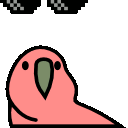

```yaml
name: dimitris_milios
description: Flutter developer by day, solder-fume enthusiast by night.
version: 2026.10.11+∞          # build number = coffees so far

environment:
  sdk: ">=3.0.0 <4.0.0"
  location: Thessaloniki, GR
  education: International Hellenic University

dependencies:
  flutter: ^production          # iOS + Android from one codebase, shipped at SmartUp
  kotlin: ^when_flutter_wont    # native Android for 1 GB-RAM car head units
  wordpress: ^custom_themes     # WooCommerce & B2B e-shops, zero page builders
  esp32: ^3.3v                  # e-ink, OLED, BLE — hand-soldered, mostly works
  firebase: ^any                # auth, Firestore, hosting, app distribution
  coffee: any                   # unconstrained on purpose

dev_dependencies:
  sleep: ^optional
  batman_logos: ^5.0.0          # yes, really — see Veldash

flutter:
  uses-material-design: true
  assets:
    - parrots/                  # mandatory
```

## Now compiling 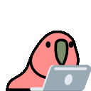

<table>
<tr>
<td width="62%">
  <a href="https://github.com/DimitrisMilios/Mokuply">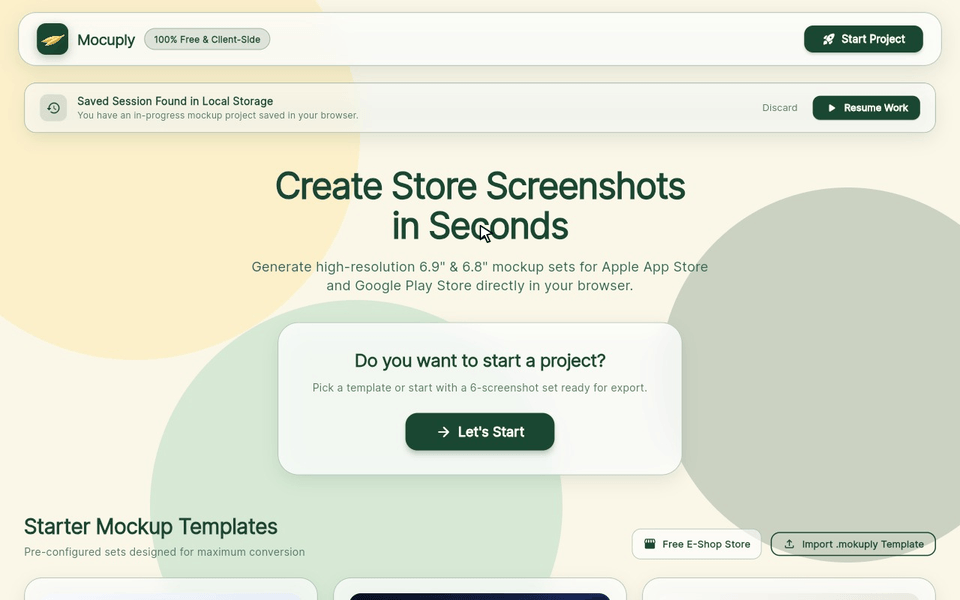</a>
</td>
<td valign="top">

### [Mokuply](https://github.com/DimitrisMilios/Mokuply) · <sub>Flutter Web</sub>

Design App Store & Google Play screenshots **in the browser**. One shared 1320×2868 canvas, realistic iPhone and Galaxy frames that swap per store, the whole Google Fonts catalogue, lossless PNG bundles.

100% client-side and open source. Nothing you upload leaves your machine, mostly because there is no server to send it to.

`flutter run -d chrome` and you're in.

</td>
</tr>
</table>

**Also on the bench:** [**Veldash**](https://github.com/DimitrisMilios/veldash) — an ultra-light offline/online navigation app for the cheap Android head units that live in dashboards (1 GB RAM, Android 5+). Native Kotlin, MapLibre, bundled vector map of Thessaloniki and BRouter routing, no Play Services. Batman-themed, because the car deserved it.

## Side quests 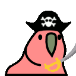

<table>
<tr>
<td valign="top" width="38%">

### [Glitched!](https://glitched-937f1.web.app/) · <sub>Flutter Web + Firebase</sub>

An asymmetric co-op riddle game for 3–6 people on 3–6 screens. One player sees the **display**, one holds the **manual**, one has the **keypad**. Talk fast, decrypt the core, and don't trust the glitches: they corrupt your screen and eat the clock.

Roles rotate every round. Bugs are the gameplay.

<sub>Host creates a core, friends join with the code, host launches. Then the shouting starts.</sub>

</td>
<td>
  <a href="https://glitched-937f1.web.app/">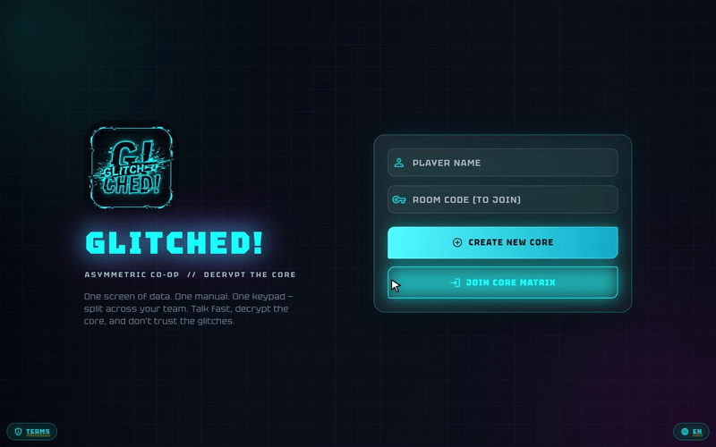</a>
</td>
</tr>
</table>

| | Project | What it is | Stack |
|---|---|---|---|
| 🖥️ | **Ink_Board** 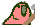 | An e-ink desk display built from scratch. Shows the time and live weather, pairs with my phone and mirrors incoming notifications. Always on, nearly zero power. | ESP32, custom firmware, BLE, Flutter companion app |
| 🧩 | [**DevDock**](https://github.com/DimitrisMilios/worksspacex) | Chrome extension that saves a project's tabs (localhost, GitHub, Jira…) as a workspace and reopens them all in one click. | Flutter Web, Chrome MV3 Tabs & Tab Groups APIs |
| 🏢 | [**ENSGAS**](https://ensgas.gr) | Two-in-one corporate portal and B2B e-shop for a natural gas company. Custom theme, Turnstile-protected forms, Consent Mode v2, zero page builders. | WordPress, WooCommerce |

## Day job

<table>
<tr>
<td width="90" align="center">
  <picture>
    <source media="(prefers-color-scheme: dark)" srcset="assets/smartup-mark-dark.svg">
    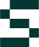
  </picture>
</td>
<td>

**Flutter developer at [SmartUp](https://smartupweb.com)**, a product studio in Thessaloniki that has been building mobile apps and web platforms since 2012. I take products from wireframe to store listing: architecture, UI, REST / Firebase / hardware integrations, release. One codebase, two stores, no excuses.

</td>
</tr>
</table>

## Loadout

<p>
  <b>Mobile</b><br>
  
</p>
<p>
  <b>Web</b><br>
  
</p>
<p>
  <b>Hardware</b><br>
  
</p>
<p>
  <b>Tools</b><br>
  
</p>

## `git log --oneline` 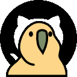

Real commit messages from my repos, lightly curated:

```
veldash   Batman logo is the default badge for Home, Work and favorites
veldash   Bundle the Thessaloniki map and routing segment in the APK
glitched  fix(wires): fix the wires game play
glitched  feat(lobby): shareable invite links, host migration, and auto-return to lobby
mokuply   feat(editor): screens strip with store rows, canvas handles, layers list, lazy font picker
ensgas    feat(corporate): Turnstile contact form, live-site hardening and deploy notes
portfolio chore(brand): rename to PAPA_JIMMI and drop the hire sticker
```

<p align="center">
  <picture>
    <source media="(prefers-color-scheme: dark)" srcset="https://github-readme-stats.vercel.app/api?username=DimitrisMilios&show_icons=true&theme=tokyonight&hide_border=true&bg_color=0d1117&title_color=46E9D4&icon_color=46E9D4&count_private=true&include_all_commits=true">
    
  </picture>
  <picture>
    <source media="(prefers-color-scheme: dark)" srcset="https://github-readme-stats.vercel.app/api/top-langs/?username=DimitrisMilios&layout=compact&theme=tokyonight&hide_border=true&bg_color=0d1117&title_color=46E9D4&langs_count=8">
    
  </picture>
</p>

<p align="center">
  <picture>
    <source media="(prefers-color-scheme: dark)" srcset="https://raw.githubusercontent.com/DimitrisMilios/DimitrisMilios/output/github-snake-dark.svg">
    
  </picture>
</p>

## Let's build something 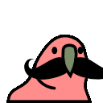

An app idea, a shop that needs a real theme, or a gadget that needs firmware and a phone to talk to. The moustache is optional.

<p>
  <a href="https://dimitrismilios.github.io/mjimmi.github.io/">dimitrismilios.github.io</a> ·
  <a href="https://www.linkedin.com/in/dimitris-milios-7a7523382/">LinkedIn</a> ·
  <a href="mailto:dimitrismilios1999@gmail.com">dimitrismilios1999@gmail.com</a>
</p>

<p align="center">
  
  <br>
  <sub>Made in Thessaloniki with Flutter, a soldering iron and an unreasonable amount of coffee.</sub>
</p>
